# SaaS Debug Lab

A hands-on lab where I practice the full SDET stack. It has a realistic distributed system (gateway, auth, tasks, Kafka event pipeline, webhooks, workers) built as the system under test. Around it sit a layered test framework, CI quality gates, load and chaos experiments, and an observability stack for diagnosing failures.

It is a personal learning project, not a product.

> Want to run it? Jump to [Run it locally](#run-it-locally). Everything else can be read without running anything.

## What this demonstrates

- **Test strategy and framework.** A pyramid of unit, contract, component, integration, e2e UI, smoke, and synthetic checks. pytest with xdist, isolated data per worker, and real Postgres, Redis, and Kafka (Redpanda in component and contract tests) instead of mocks. See [testing/README.md](testing/README.md).
- **Defects found by the framework.** 14 found, 9 fixed, 5 deferred or open with a plan. An open defect stays an `xfail(strict=True)` test until it is fixed. See [Findings](#findings).
- **CI quality gates.** Path-based test selection, pytest-split sharding (one shard today), a single required check (`ci-gate`), nightly Schemathesis and cross-browser runs, dependency and secret scans.
- **Testability and debugging.** Traces, logs, metrics, and errors are linked by `trace_id` (Jaeger, Kibana, Grafana, Sentry). The test stack can export traces to Jaeger, so one test call can be followed across services.
- **Non-functional testing.** k6 load scenarios, chaos experiments, and synthetic probes.

  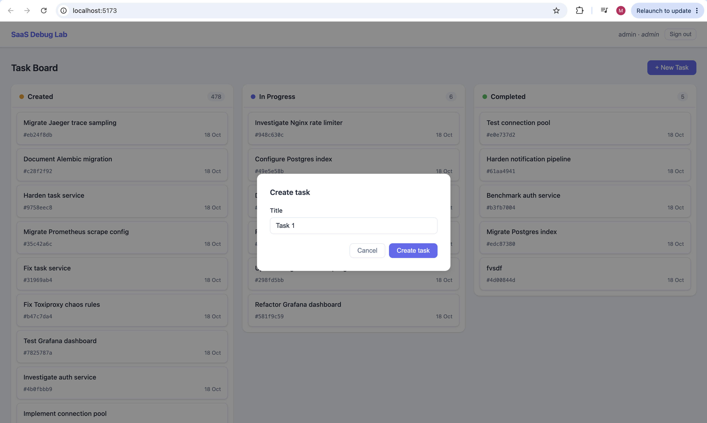

## Architecture

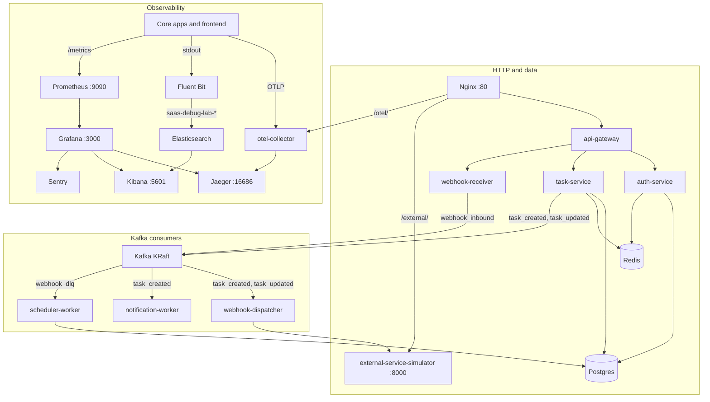

| Doc                   | Page                                                                                   |
| --------------------- | -------------------------------------------------------------------------------------- |
| Architecture          | [docs/system-architecture/ARCHITECTURE.md](docs/system-architecture/ARCHITECTURE.md)   |
| Service map and ports | [docs/system-architecture/SERVICE_MAP.md](docs/system-architecture/SERVICE_MAP.md)     |
| Setup                 | [docs/system-architecture/setup.md](docs/system-architecture/setup.md)                 |
| Observability         | [docs/system-architecture/observability.md](docs/system-architecture/observability.md) |
| Test framework        | [testing/README.md](testing/README.md)                                                 |
| Load testing          | [load-tests/README.md](load-tests/README.md)                                           |
| Chaos engineering     | [chaos/README.md](chaos/README.md)                                                     |

## Testing

The framework runs the same flows in process and against a Docker Compose test stack. The swap point is the injected `httpx.AsyncClient` transport.

| Layer       | What it checks                                                               |
| ----------- | ---------------------------------------------------------------------------- |
| unit        | Test kit self-tests                                                          |
| contract    | OpenAPI validity and snapshots, Schemathesis, consumer models, event schemas |
| component   | One service in process, real commits, real Redis and Kafka                   |
| integration | Cross-service effects and the Nginx edge on the `saas-test` stack            |
| e2e UI      | Playwright against the built frontend                                        |
| smoke       | Edge health, seeded login, create and read, `/metrics`, frontend             |
| synthetic   | k6 critical path on the dev lab                                              |

The suite has 220 pytest cases plus one synthetic k6 script. `ci-gate` is the only required status check. A skipped job counts as a pass, a failed or cancelled job fails the gate.

<table>
  <tr>
    <td width="50%">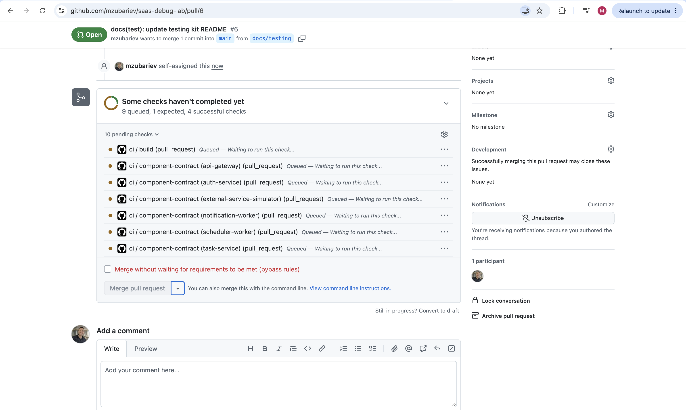 Pull request blocked by a failing gate</td>
    <td width="50%">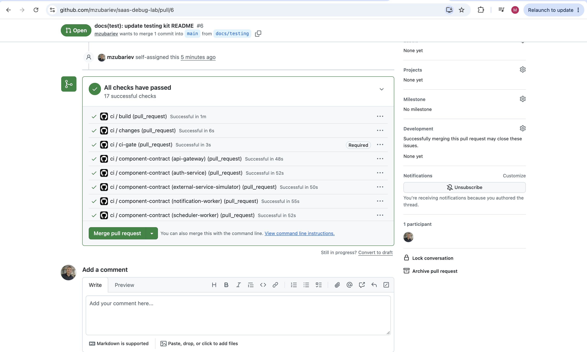 Pull request, all checks passed</td>
  </tr>
</table>

- **Traced runs.** `make t-int-traced` adds a Jaeger sink to the test stack (UI on `localhost:16687`), so one test call can be followed across services.
- **Synthetic probes.** `make t-synthetic` runs `testing/synthetic/k6/critical_path.js` against the dev lab. The same script runs as a Grafana Synthetic Monitoring scripted check. It stays off `ci-gate`.

  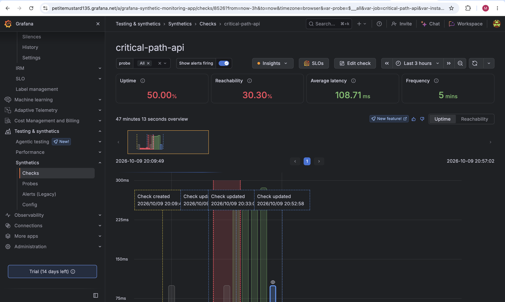

Full detail: [testing/README.md](testing/README.md).

## Findings

Every defect is a test first. While a defect is open the test is `xfail(strict=True)`, so fixing the bug flips the test and forces the marker to be removed. A selection of the 14 findings:

| ID     | Found by    | Impact                                                                                                                 | Status                                                    | Test                                                   |
| ------ | ----------- | ---------------------------------------------------------------------------------------------------------------------- | --------------------------------------------------------- | ------------------------------------------------------ |
| BUG-1  | integration | The `/auth/token` rate limit is inactive. The zone key is an empty `Authorization` header, which nginx does not count. | Deferred. The fix needs a test-stack and k6 rework first. | `test_login_burst_without_a_bearer_is_not_limited`     |
| BUG-3  | component   | task-service commits, then publishes. A Kafka failure returns 500, leaves the row, and loses the event.                | Deferred. The fix is a transactional outbox.              | `test_create_publish_failure_stores_nothing`           |
| BUG-5  | component   | `POST /webhooks/inbound` returned 500 because a log keyword clashed with structlog's `event`.                          | Fixed                                                     | `test_inbound_returns_received`                        |
| BUG-7  | integration | The dispatcher reuses `Idempotency-Key = payload.id` across `task_created` and `task_updated`.                         | Deferred. The key choice is a product decision.           | `test_created_task_reaches_kafka_mail_and_webhooks`    |
| BUG-9  | contract    | A NUL byte in the login username caused a 500 from Postgres. Found by Schemathesis.                                    | Fixed                                                     | `test_login_with_a_nul_username_is_not_a_server_error` |
| BUG-12 | component   | scheduler-worker never retries a 5xx on DLQ replay.                                                                    | Open                                                      | `test_replay_retries_when_the_receiver_returns_5xx`    |

All findings: [testing/README.md](testing/README.md#findings).

## Observability

The lab runs a full observability stack, so any failure in the running system can be investigated: one trace_id leads from a metric or a log line to the trace, the related logs, and the error.

Apps export OTLP to the collector, and Jaeger shows the traces. Fluent Bit writes logs to Elasticsearch, and Kibana reads them. Prometheus scrapes `/metrics`, and Grafana shows dashboards and sends alerts to Telegram. Sentry starts when `SENTRY_DSN` is set.

A Prometheus exemplar carries `trace_id` into Grafana Explore and Jaeger. The Jaeger trace opens the Elasticsearch logs for that id. A log row opens Kibana Discover and Sentry on the same id. The gallery follows that path, from dashboard to alert.

<table>
  <tr>
    <td width="50%">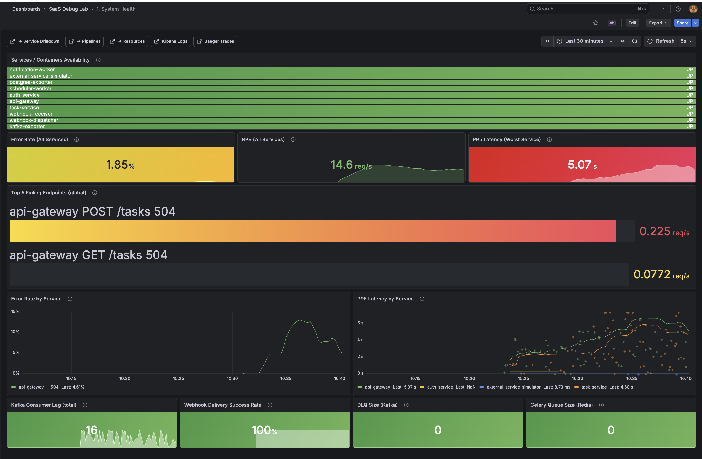 Grafana: system health dashboard</td>
    <td width="50%">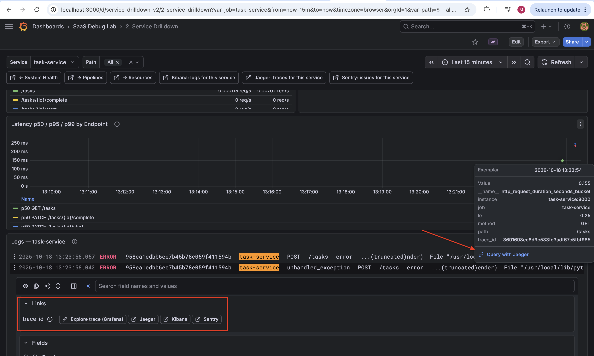 Grafana: exemplars and log links by trace_id</td>
  </tr>
  <tr>
    <td width="50%">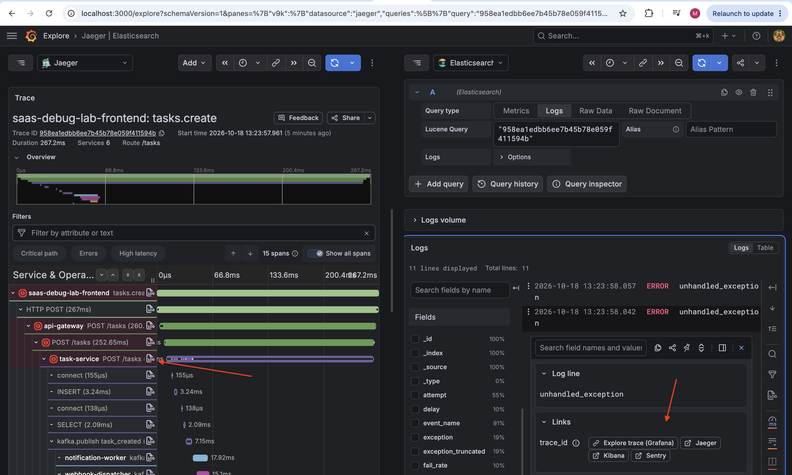 Grafana Explore: logs and traces side by side</td>
    <td width="50%">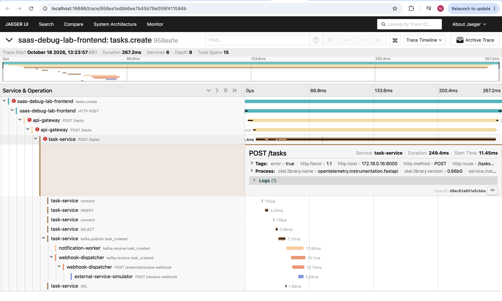 Jaeger: one request across services</td>
  </tr>
  <tr>
    <td width="50%">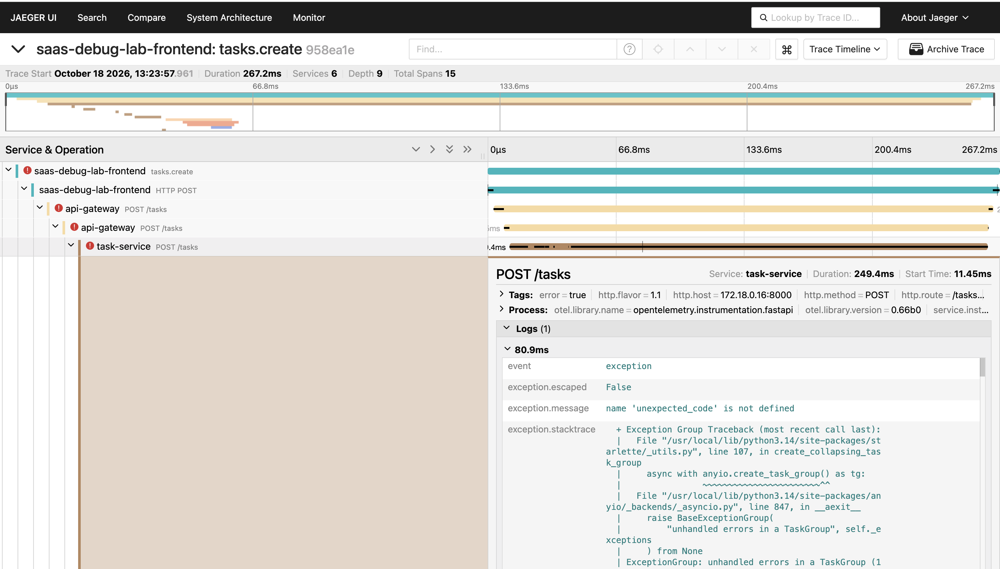 Jaeger: error log inside the trace</td>
    <td width="50%">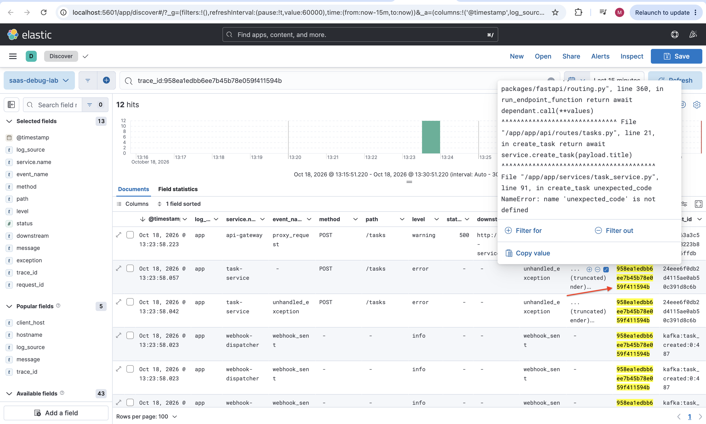 Kibana: error log with a link back to Jaeger</td>
  </tr>
  <tr>
    <td width="50%">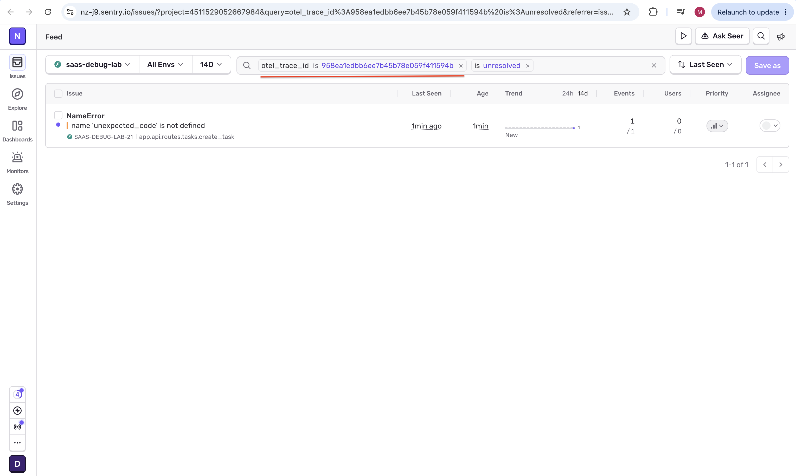 Sentry: issues filtered by trace id</td>
    <td width="50%">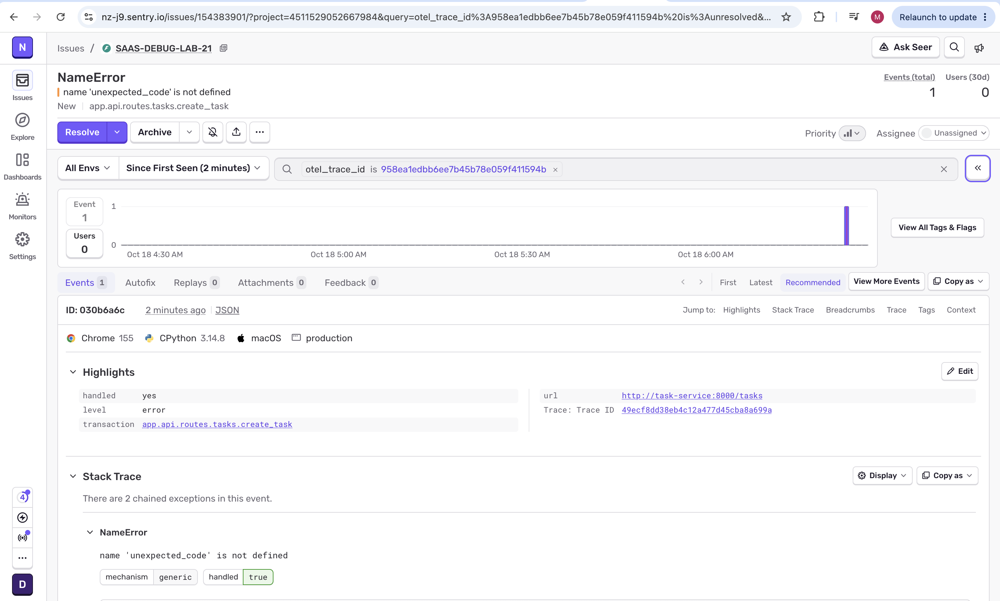 Sentry: issue page</td>
  </tr>
  <tr>
    <td width="50%">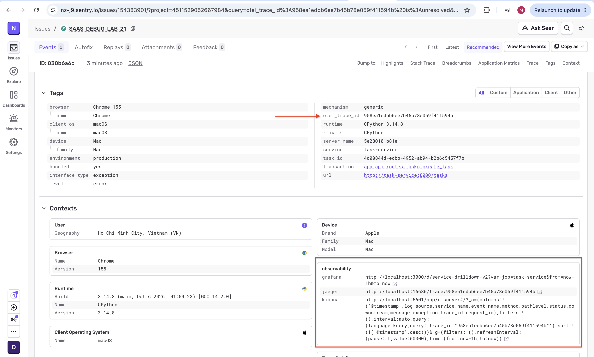 Sentry: links to Grafana, Jaeger, and Kibana</td>
    <td width="50%">
      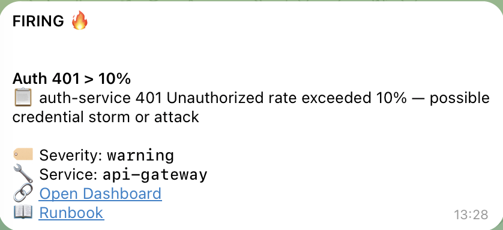
      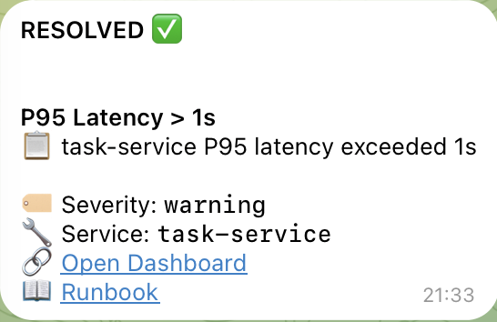
       Telegram: alert firing and resolved
    </td>
  </tr>
</table>

Full stack description: [docs/system-architecture/observability.md](docs/system-architecture/observability.md).

## Load testing

k6 1.7.1 scenarios hit Nginx, Redis, Postgres, Kafka, and the webhook retry path (`make load-baseline`, `load-spike`, `load-retry-storm`, `load-concurrency`, `load-slow-clients`, `load-chaos`). A plain run is an SLO run with thresholds. `CHAOS=1` prints metrics and clears thresholds. Details: [load-tests/README.md](load-tests/README.md).

## Chaos

Scenarios in `chaos/scenarios/` combine single-fault primitives with a k6 load run (`make chaos-scenario SCENARIO=<name>`, `make chaos-random`). Each scenario cleans up on exit. Details: [chaos/README.md](chaos/README.md).

## Run it locally

You need Docker with Compose. The full guide with every command, env variable, port, and login is [docs/system-architecture/setup.md](docs/system-architecture/setup.md). The steps in short:

1. Copy the env files ([Environment](docs/system-architecture/setup.md#environment)).
2. Start the `core` profile, then `observability` ([Start](docs/system-architecture/setup.md#start)).
3. Seed users and tasks ([Seed](docs/system-architecture/setup.md#seed)). Postgres is not published to the host, so the seed runs inside its network.
4. Do the four manual steps below ([Manual steps](docs/system-architecture/setup.md#manual-steps)).
5. Open the UI at `http://localhost:5173` and log in as `admin` / `admin123`.

### Known issues and manual steps

- [Kibana data view](docs/system-architecture/setup.md#kibana-data-view): create `saas-debug-lab` by hand after the first start.
- [Grafana Telegram contact point](docs/system-architecture/setup.md#grafana-telegram): set the bot token and chat id before the first Grafana start.
- [Grafana interlinking](docs/system-architecture/setup.md#grafana-interlinking): paste `${__value.raw}` into every Elasticsearch data link by hand.
- [Grafana Explore traces](docs/system-architecture/setup.md#grafana-explore-traces): select the TraceID query type by hand after jumping from an exemplar.
- Product defects found by the tests: [Findings](testing/README.md#findings).

## Roadmap

- Full R0: a `pyproject` per service, a uv workspace, and `src/`.
- BUG-1: nginx zone-key fix, together with the test-stack and k6 rework.
- BUG-3: transactional outbox.
- BUG-7: idempotency key (product decision).
- Async scheduler-worker.
- Layered services (api / application / domain / infrastructure).
- Producer-side Kafka event models.
- AuthZ on the `role` claim. Login writes it, but no route checks it.
- Pagination on `GET /tasks`. The board pages on the client.

