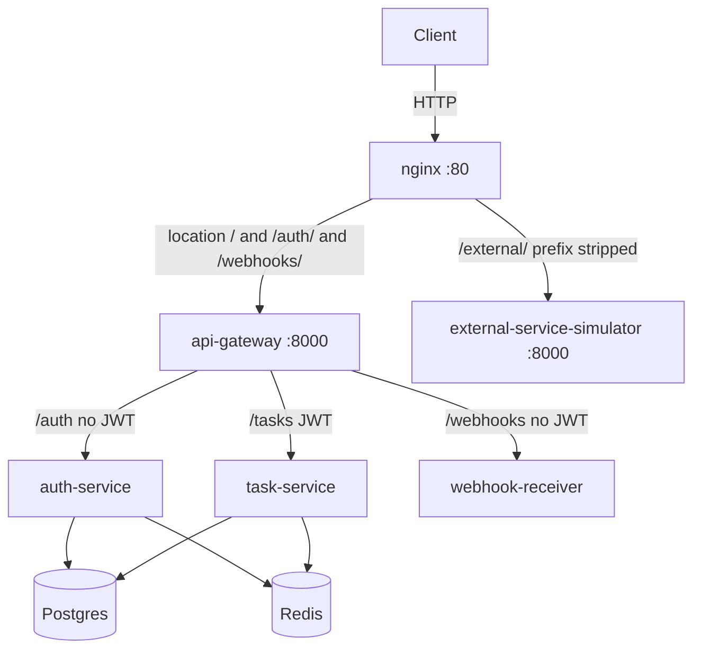
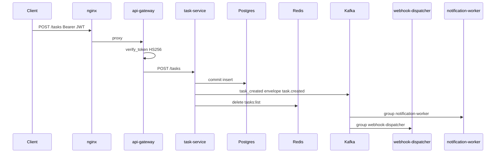
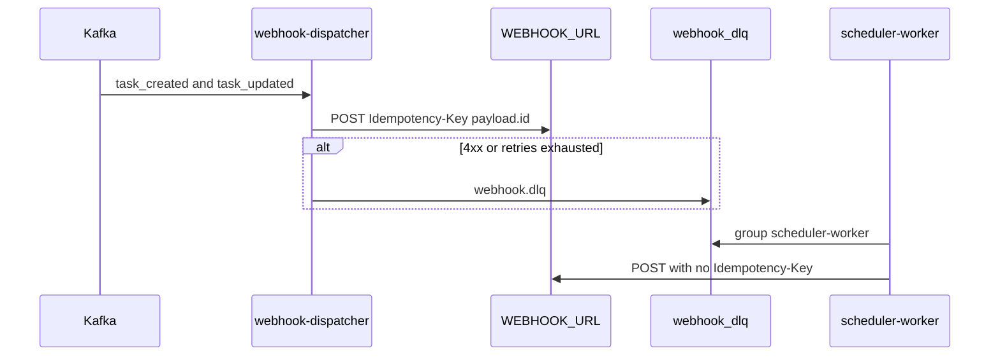
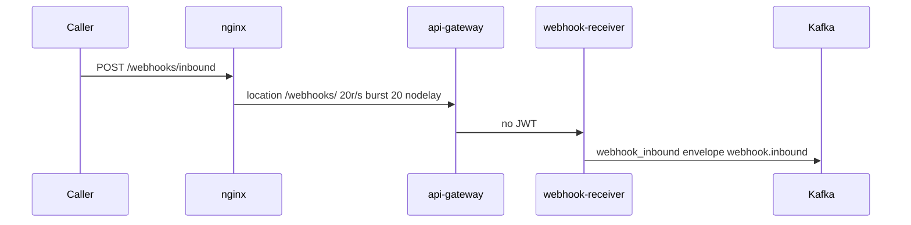
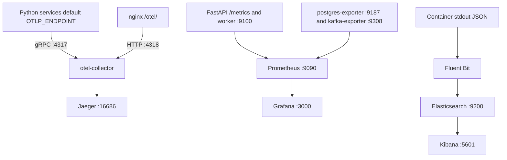
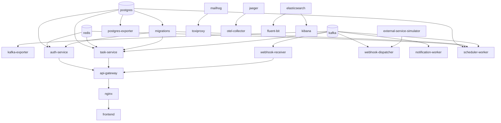

# Service Map

Ports and edges come from `infra/docker-compose.yml`. The test overlay is `infra/docker-compose.test.yml`. Behaviour is in [Architecture](./ARCHITECTURE.md).

## Lab ports

Host `—` means `docker-compose.yml` does not publish the port. Container ports are the ones Compose, healthchecks, or the SUT map name.

| Service                    | Host  | Container                                | Profile       |
| -------------------------- | ----- | ---------------------------------------- | ------------- |
| nginx                      | 80    | 80                                       | core          |
| api-gateway                | —     | 8000                                     | core          |
| auth-service               | —     | 8000                                     | core          |
| task-service               | —     | 8000                                     | core          |
| webhook-receiver           | —     | 8000                                     | core          |
| external-service-simulator | 8000  | 8000                                     | core          |
| webhook-dispatcher         | —     | 9100 (`METRICS_PORT`)                    | core          |
| notification-worker        | —     | 9100 (`METRICS_PORT` default)            | core          |
| scheduler-worker           | —     | 9100 (`METRICS_PORT`; one prefork child) | core          |
| frontend                   | 5173  | 5173                                     | core          |
| postgres                   | —     | 5432                                     | core          |
| postgres-exporter          | —     | 9187                                     | core          |
| redis                      | —     | 6379                                     | core          |
| kafka                      | —     | 9092, 9093, 9094                         | core          |
| kafka-exporter             | —     | 9308                                     | core          |
| mailhog                    | 8025  | 8025                                     | core          |
| toxiproxy                  | 8474  | 8474                                     | core          |
| migrations                 | —     | —                                        | core          |
| jaeger                     | 16686 | 16686                                    | observability |
| otel-collector             | —     | 4317 (gRPC), 4318 (HTTP)                 | observability |
| prometheus                 | 9090  | 9090                                     | observability |
| grafana                    | 3000  | 3000                                     | observability |
| fluent-bit                 | —     | —                                        | observability |
| elasticsearch              | —     | 9200                                     | observability |
| kibana                     | 5601  | 5601                                     | observability |

Kafka binds `PLAINTEXT://kafka:9092`, `CONTROLLER://kafka:9094`, and `PLAINTEXT_HOST://0.0.0.0:9093`. Lab advertised `PLAINTEXT_HOST` is `localhost:9093`, and that port is not published. MailHog SMTP `1025` is not published. Worker SMTP targets `toxiproxy` on `SMTP_PORT` (default `11025`); Compose does not publish `11025`. Elasticsearch is `http://elasticsearch:9200` on the Compose network and is not published to the host.

Redis container `6379` is the port the test overlay maps (`6381:6379`). Postgres container `5432` is the port the test overlay maps (`5434:5432`) and the Alembic default.

## Test overlay ports

`infra/docker-compose.test.yml` is project `saas-test`. It does not change `docker compose --profile core`. `container_name` is reset. Images are `saas-test-<service>:latest`. Compose `>= 2.24` is required so `!override` replaces host ports. `infra/test-stack.services` is the explicit service list; exporters stay out of that list. `OTLP_ENDPOINT` and `SENTRY_DSN` are empty.

| Service                               | Host | Container |
| ------------------------------------- | ---- | --------- |
| nginx                                 | 9080 | 80        |
| frontend (`preview` stage)            | 5174 | 5173      |
| api-gateway                           | 8010 | 8000      |
| external-service-simulator            | 8002 | 8000      |
| postgres                              | 5434 | 5432      |
| redis                                 | 6381 | 6379      |
| kafka                                 | 9095 | 9093      |
| webhook-dispatcher                    | 9111 | 9100      |
| notification-worker                   | 9112 | 9100      |
| scheduler-worker                      | 9113 | 9100      |
| mailhog                               | 8026 | 8025      |
| toxiproxy                             | 8475 | 8474      |
| wiremock (`wiremock/wiremock:3.13.1`) | 8089 | 8080      |

Kafka advertised `PLAINTEXT_HOST` in this file is `localhost:9095`. Gateway `CORS_ORIGINS` is `http://127.0.0.1:5174,http://localhost:5174`. The frontend build arg `VITE_API_URL` is `http://127.0.0.1:9080`. Dispatcher and scheduler `WEBHOOK_URL` is `http://wiremock:8080/external/receive-webhook`. Simulator `INTEGRATION_SERVICE_WEBHOOK_URL` is `http://api-gateway:8000/webhooks/inbound`. Scheduler `DLQ_REPLAY_INTERVAL_SECONDS` is `5` and `CLEANUP_INTERVAL_SECONDS` is `10`. Dispatcher `WEBHOOK_BACKOFF_BASE` is `0.2`.

`infra/docker-compose.test.tracing.yml` is included only when `TRACING=1`. It clears Jaeger's profile, sets `SPAN_STORAGE_TYPE=memory`, publishes `16687:16686` and `4319:4317`, and sets every Python service `OTLP_ENDPOINT` to `http://jaeger:4317`. Lab Jaeger keeps host `16686`.

## Synchronous HTTP

`POST /auth/token` is form-encoded. The gateway returns the auth-service token body. `GET /auth/me` decodes the Bearer token and does not read Postgres. Task routes at the gateway require a token; task-service does not check it again.

## Task creation

A Kafka failure after the commit returns 500 and leaves the row (BUG-3). The cache delete does not run in that case. `task_updated` (`task.updated`) follows the same publish-after-commit path on `start` and `complete`, and only webhook-dispatcher consumes it.

## Webhook outbound

`WEBHOOK_URL` is required and has no code default. The lab templates set `http://nginx/external/receive-webhook` on both webhook-dispatcher and scheduler-worker. The test overlay sets `http://wiremock:8080/external/receive-webhook`. The dispatcher waits on external-service-simulator being healthy. Backoff and BUG-7 / BUG-12 are in the [architecture timings](./ARCHITECTURE.md).

## Webhook inbound

No service in this repo consumes `webhook_inbound`. `POST /trigger-event` on the simulator returns 202 and then POSTs to `INTEGRATION_SERVICE_WEBHOOK_URL`. The lab template sets `http://localhost/webhooks/inbound`, which inside the simulator container is the simulator itself. The test overlay points that URL at `http://api-gateway:8000/webhooks/inbound`. Gateway `AUTH_SERVICE_URL`, `TASK_SERVICE_URL`, and `INTEGRATION_SERVICE_URL` are in the [lab URL templates](./ARCHITECTURE.md#lab-url-templates).

## Observability

The collector config is `observability/otel-collector/otel-collector-config.yaml`. Compose labels that hop as OTLP to Jaeger. Scrape jobs are whatever `observability/prometheus/prometheus.yml` lists. Sentry starts only when `SENTRY_DSN` is set (`traces_sample_rate` 0.1). The test stack leaves `OTLP_ENDPOINT` empty unless `docker-compose.test.tracing.yml` is included.

## Dependency graph

An arrow runs from the dependency to the service that waits on it. `webhook-dispatcher`, `notification-worker`, and `scheduler-worker` have no healthcheck, so nothing waits on them. The test kit uses their metrics port. Toxiproxy has no healthcheck. `migrations` is a one-shot `alembic upgrade head`.

| Service             | Waits for                                    | Condition                        |
| ------------------- | -------------------------------------------- | -------------------------------- |
| migrations          | postgres                                     | `service_healthy`                |
| postgres-exporter   | postgres                                     | `service_healthy`                |
| kafka-exporter      | kafka                                        | `service_healthy`                |
| auth-service        | postgres, redis                              | `service_healthy`                |
| auth-service        | migrations                                   | `service_completed_successfully` |
| task-service        | postgres, kafka, redis                       | `service_healthy`                |
| task-service        | migrations                                   | `service_completed_successfully` |
| webhook-receiver    | kafka                                        | `service_healthy`                |
| api-gateway         | auth-service, task-service, webhook-receiver | `service_healthy`                |
| nginx               | api-gateway                                  | `service_healthy`                |
| webhook-dispatcher  | kafka, external-service-simulator            | `service_healthy`                |
| notification-worker | kafka                                        | `service_healthy`                |
| scheduler-worker    | redis, postgres, kafka                       | `service_healthy`                |
| scheduler-worker    | migrations                                   | `service_completed_successfully` |
| toxiproxy           | mailhog                                      | `service_started`                |
| frontend            | nginx                                        | `service_started`                |
| otel-collector      | jaeger                                       | `service_started`                |
| fluent-bit          | elasticsearch                                | `service_started`                |
| kibana              | elasticsearch                                | `service_started`                |

The test overlay also waits on `wiremock` (`service_started`) from webhook-dispatcher and scheduler-worker. Postgres, Redis, Kafka, the simulator, MailHog, Jaeger, Prometheus, Grafana, and Elasticsearch have no `depends_on`.

## Kafka topics

| Topic             | event_type        | Producer                                                              | Consumer group                              |
| ----------------- | ----------------- | --------------------------------------------------------------------- | ------------------------------------------- |
| `task_created`    | `task.created`    | task-service                                                          | `notification-worker`; `webhook-dispatcher` |
| `task_updated`    | `task.updated`    | task-service                                                          | `webhook-dispatcher`                        |
| `webhook_inbound` | `webhook.inbound` | webhook-receiver (`TOPIC_WEBHOOK_INBOUND`, default `webhook_inbound`) | none in this repo                           |
| `webhook_dlq`     | `webhook.dlq`     | webhook-dispatcher                                                    | `scheduler-worker`                          |

Payload shapes and the v1 envelope are in [Architecture](./ARCHITECTURE.md).