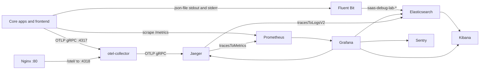

# Observability

Started with the `observability` profile (Jaeger, otel-collector, Prometheus, Grafana, Fluent Bit, Elasticsearch, Kibana). App containers stay on `core`. Setup, env vars, and the Kibana / Grafana clicks are in [setup.md](setup.md).

## Logs

Fluent Bit 3.0 tails `/var/lib/docker/containers/*/*.log`.

Stdout (`docker.*`): keep `stream` stdout, parse the `log` field with parser `structlog_json`, keep records whose `level` is `debug`, `info`, `warning`, `error`, or `critical`, drop paths `/health`, `/metrics`, `/readyz`, and `/livez`, rename `event` to `event_name`, add `log_source=app`.

Stderr (tag `stderr`): drop empty lines, Fluent Bit's own lines, and Celery text lines. Rename `log` to `message`, set `level=error` and `log_source=stderr`.

Both pipelines use the Elasticsearch output: host `elasticsearch`, port `9200`, `Logstash_Format` on, prefix `saas-debug-lab`, date format `%Y.%m.%d`. Indices are `saas-debug-lab-YYYY.MM.DD`.

Elasticsearch 8.11.0 is single-node with `xpack.security.enabled: "false"` and `ES_JAVA_OPTS=-Xms512m -Xmx512m`. It has no host port. Kibana 8.11.0 is published on host `5601`. Create the data view as in [setup.md](setup.md#kibana-data-view). Timestamp field: `@timestamp` (Grafana `timeField`).

## Metrics

Prometheus image `prom/prometheus`, config `observability/prometheus/prometheus.yml`, storage `/prometheus`, exemplar storage enabled (`--enable-feature=exemplar-storage`). Scrape interval `15s`, evaluation interval `15s`. UI on host `9090`.

`rule_files: ./rules/*.yml`. Compose mounts `observability/prometheus/rules` at `/etc/prometheus/rules`.

| Job                          | Target                            |
| ---------------------------- | --------------------------------- |
| `api-gateway`                | `api-gateway:8000`                |
| `auth-service`               | `auth-service:8000`               |
| `task-service`               | `task-service:8000`               |
| `webhook-receiver`           | `webhook-receiver:8000`           |
| `external-service-simulator` | `external-service-simulator:8000` |
| `webhook-dispatcher`         | `webhook-dispatcher:9100`         |
| `notification-worker`        | `notification-worker:9100`        |
| `scheduler-worker`           | `scheduler-worker:9100`           |
| `kafka-exporter`             | `kafka-exporter:9308`             |
| `postgres-exporter`          | `postgres-exporter:9187`          |

FastAPI `/metrics` is OpenMetrics when `Accept` contains `application/openmetrics-text`, otherwise Prometheus text. scheduler-worker sets `PROMETHEUS_MULTIPROC_DIR=/tmp/prometheus_multiproc_scheduler` and binds `9100` in one prefork child.

Grafana (`grafana/grafana`, host `3000`) provisions datasources from `observability/grafana/provisioning` (file `datasources/prometheus.yaml`):

| Datasource    | uid             | URL                                                                            |
| ------------- | --------------- | ------------------------------------------------------------------------------ |
| Prometheus    | `prometheus`    | `http://prometheus:9090` (default)                                             |
| Jaeger        | `jaeger`        | `http://jaeger:16686`                                                          |
| Elasticsearch | `elasticsearch` | `http://elasticsearch:9200`, index `saas-debug-lab-*`, time field `@timestamp` |

## Traces

otel-collector `0.96.0` receives OTLP gRPC on `0.0.0.0:4317` and OTLP HTTP on `0.0.0.0:4318` (CORS: `http://localhost:5173`, `http://127.0.0.1:5173`, `http://localhost`, `http://127.0.0.1`). It exports OTLP gRPC to `jaeger:4317` with TLS insecure. Compose does not publish `4317` or `4318`.

Jaeger `jaegertracing/all-in-one:1.55`, `COLLECTOR_OTLP_ENABLED=true`, UI on host `16686`.

Services default `OTLP_ENDPOINT` to `http://otel-collector:4317` (gRPC). When `VITE_OTEL_EXPORTER_OTLP_TRACES_ENDPOINT` is unset, the browser sends traces to `http://localhost/otel/v1/traces`. Nginx `location /otel/` proxies that to `otel-collector:4318` (`burst=20 nodelay`, `client_max_body_size 1m`). The hop exists while the `observability` profile is up.

The test stack has its own opt-in Jaeger, see [testing/README.md](../../testing/README.md).

## Errors

Sentry is optional. An empty DSN skips `sentry_sdk.init`. Compose passes `SENTRY_DSN` into the core app services and `VITE_SENTRY_DSN` into the frontend. Backend `traces_sample_rate` is `0.1` when a DSN is set (`shared/saas_shared/sentry_setup.py`). The frontend sample rate is `VITE_SENTRY_TRACES_SAMPLE_RATE` (Compose default `1.0`).

The Elasticsearch data link "Sentry" has this shape, with your own organisation and project:

`https://<org>.sentry.io/issues/?project=<project-id>&query=otel_trace_id%3A${__value.raw}%20is%3Aunresolved&referrer=issue-list&statsPeriod=14d`

## How they link

| From                | To                       | Mechanism                                                                                                                                                                                                                                             |
| ------------------- | ------------------------ | ----------------------------------------------------------------------------------------------------------------------------------------------------------------------------------------------------------------------------------------------------- |
| App logs            | Elasticsearch            | Fluent Bit keeps the parsed JSON fields. Grafana links and the Kibana Discover query use the log field `trace_id`                                                                                                                                     |
| Prometheus exemplar | Jaeger                   | Exemplar label `trace_id` → datasource uid `jaeger`. In Explore, set query type TraceID and search ([setup](setup.md#grafana-explore-traces))                                                                                                         |
| Jaeger trace        | Elasticsearch logs       | `tracesToLogsV2`: datasource `elasticsearch`, `filterByTraceID: true`, `customQuery: trace_id:${__value.raw}`                                                                                                                                         |
| Jaeger trace        | Prometheus               | `tracesToMetrics`: datasource `prometheus`, span window `-2m` to `2m`                                                                                                                                                                                 |
| Log row `trace_id`  | Grafana Explore / Jaeger | Data link "Explore trace (Grafana)": url `${__value.raw}`, `datasourceUid: jaeger`. Derived field "Open trace in Jaeger" uses the same url                                                                                                            |
| Log row `trace_id`  | Jaeger UI                | `${JAEGER_BASE_URL}/trace/${__value.raw}`                                                                                                                                                                                                             |
| Log row `trace_id`  | Kibana Discover          | `${KIBANA_BASE_URL}` Discover, KQL `trace_id:${__value.raw}`, last 15 minutes. Columns: `@timestamp`, `log_source`, `service.name`, `event_name`, `method`, `path`, `level`, `status`, `downstream`, `message`, `exception`, `trace_id`, `request_id` |
| Log row `trace_id`  | Sentry                   | `otel_trace_id` query on the Sentry project URL above                                                                                                                                                                                                 |

`JAEGER_BASE_URL` defaults to `http://localhost:16686` and `KIBANA_BASE_URL` to `http://localhost:5601`. After provisioning, paste `${__value.raw}` back into every Elasticsearch data link ([setup](setup.md#grafana-interlinking)).

Kafka envelopes also carry `trace_id` (`event_type`, `version` `v1`, `timestamp`, `payload`). Task producers add W3C headers and, on task-service, `sentry-trace` and `baggage`.

## Ports

Host ports are published mappings. Other rows are container or in-network only.

| Component         | Host    | Container / in-network                                                       |
| ----------------- | ------- | ---------------------------------------------------------------------------- |
| Jaeger UI         | `16686` | `16686`; OTLP from the collector at `jaeger:4317`                            |
| Prometheus UI     | `9090`  | `9090`                                                                       |
| Grafana           | `3000`  | `3000`                                                                       |
| Kibana            | `5601`  | `5601`                                                                       |
| otel-collector    | none    | `4317` gRPC, `4318` HTTP                                                     |
| Elasticsearch     | none    | `9200` (Fluent Bit and Grafana)                                              |
| Fluent Bit        | none    | none published                                                               |
| Nginx `/otel/`    | `80`    | proxies to `otel-collector:4318`                                             |
| App `/metrics`    | none    | `:8000` on gateway, auth, task, webhook-receiver, external-service-simulator |
| Worker `/metrics` | none    | `:9100` on webhook-dispatcher, notification-worker, scheduler-worker         |
| kafka-exporter    | none    | `9308`                                                                       |
| postgres-exporter | none    | `9187`                                                                       |

Related `core` UIs: frontend `5173`, MailHog `8025`.

## Dashboards and alerts

| Kind          | Name                                                                                              | Where                                                            |
| ------------- | ------------------------------------------------------------------------------------------------- | ---------------------------------------------------------------- |
| Dashboards    | System Health, Service Drilldown, Pipelines (Kafka · Webhooks · Celery), Resources & Dependencies | `observability/grafana/provisioning/`                            |
| Alert rules   | SaaS Debug Lab — Critical, SaaS Debug Lab — Warning                                               | `observability/prometheus/rules/`                                |
| Contact point | `telegram` (uid `telegram-receiver`, type `telegram`, `parseMode: HTML`)                          | `observability/grafana/provisioning/alerting/contact-points.yml` |

Firing and resolved alerts are delivered to Telegram through the Grafana contact point `telegram`. The message uses `alertname`, the annotations `summary`, `description`, `dashboard`, and `runbook`, and the labels `severity` and `job`. Bot token and chat id come from `TELEGRAM_BOT_TOKEN` and `TELEGRAM_CHAT_ID`.

## Screenshots

### Dashboards (Grafana)

  

- Grafana exemplars lead to Grafana Explore tracing by `trace_id`.
- Logs have external links to Jaeger, Kibana, and Sentry with a predefined `trace_id` filter.

  

Grafana Explore with logs and traces linked:

  

### Logs (Kibana)

The `trace_id` values are links to Jaeger.

  

### Traces (Jaeger)

  

  

### Errors (Sentry)

  

Sentry issues carry a context with links to Grafana, Jaeger, and Kibana, filtered by `trace_id`:

  

### Alerts (Telegram)

  
  

