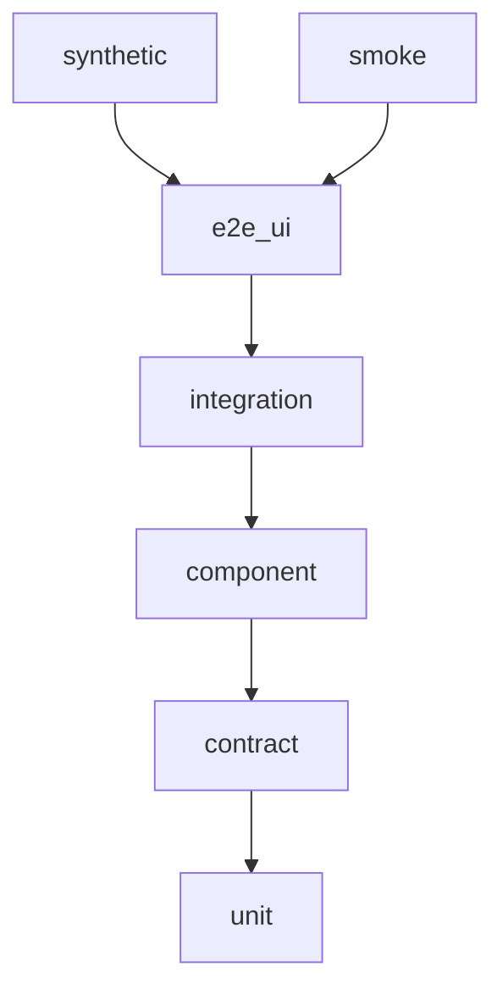
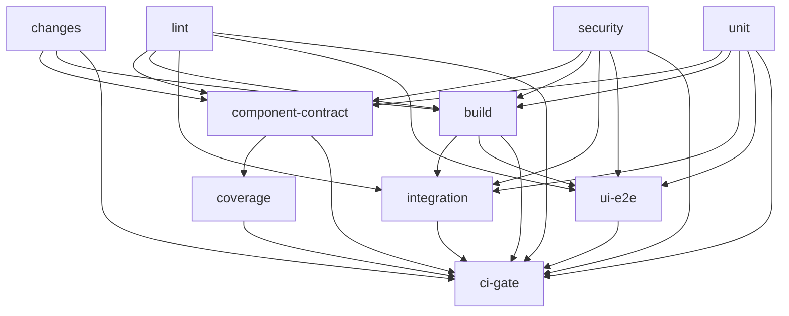

# saas-testkit

## Purpose

Installable test kit for saas-debug-lab (`testing/src/saas_testkit`).
The same flows run in-process and against the compose stack; the injected `httpx.AsyncClient` transport is the swap point.
A defect the suite can observe stays `xfail(strict=True)` and is listed in [KNOWN_ISSUES.md](KNOWN_ISSUES.md).

## Layers

| Layer | What runs | Infra | Parallelism | CI cadence |
| --- | --- | --- | --- | --- |
| unit | `saas_testkit` self-tests | none | `-n auto` | PR and main |
| contract | OpenAPI validity and snapshots, Schemathesis, consumer models, event schemas | Postgres, Redis, Redpanda | `-n auto` | PR and main, inside `component-contract`, `SCHEMA_EXAMPLES=40`. Nightly: five HTTP services, `SCHEMA_EXAMPLES=500` |
| component | One service in-process (`--service`), ASGI, real commits | Worker database, worker Redis index, Redpanda | `-n auto` | PR: services in the path filter. Main: all eight |
| integration | Cross-service effects and the nginx edge | Test stack, project `saas-test` | `-n 3`, `--dist loadgroup` | PR: `-m "not slow and not chaos"`, only when the stack filter is on. Main: `-m "not chaos"`. Nightly: `slow` and `chaos`, then `--count 5` |
| e2e_ui | Sync Playwright | Same stack. `UI_URL` `http://127.0.0.1:5174` | `-n 2` | PR: `-m critical`. Main: full Chromium. Nightly: Firefox and WebKit |
| smoke | Edge health, seeded login, create/read, `/metrics`, frontend | `SMOKE_BASE_URL` | `-n 0` | Step inside `integration` on PR and main. `smoke.yml` is `workflow_call` / `workflow_dispatch` |
| synthetic | `testing/synthetic/k6/critical_path.js` | Dev lab | one k6 iteration | Not a job in `ci.yml`, `nightly.yml`, or `smoke.yml` |

On a pull request, `changes` limits `component-contract` to touched services. `build`, `integration`, and `ui-e2e` run when the push is to `main`, or when the diff touches `testing/**`, `shared/**`, `infra/**`, `migrations/**`, `.github/**`, a `uv.lock`, or `frontend/**`. A skipped job is a passing input to `ci-gate`.

## How to run

From the repo root. Component syncs its group; contract needs that group installed first (`cd testing && uv sync --group <service>`).

| Layer | Command |
| --- | --- |
| unit | `make t-unit` |
| component | `make deps-up` then `make t-component SERVICE=task-service` |
| component, all services | `make t-component-all` |
| contract | `make t-contract SERVICE=task-service` |
| integration | `make t-int` |
| e2e_ui | `make t-ui` |
| smoke | `make t-smoke` |
| synthetic | `make t-synthetic` |

`make t-gate LAYER=unit` runs that layer three times. `LAYER=component` and `LAYER=contract` also need `SERVICE=`. Smoke exits unless `SMOKE_BASE_URL` is set and `/health` is 200 `{"status":"ok"}`.

## Counts

From [TEST_CATALOG.md](docs/local/TEST_CATALOG.md) totals. Pytest cases: 220. Synthetic is not a pytest item.

| Layer | Cases |
| --- | --- |
| unit | 62 |
| component | 104 |
| contract | 35 |
| integration | 8 |
| e2e_ui | 4 |
| smoke | 7 |
| synthetic | 1 k6 script |

## Key decisions

Full write-up: [TESTING_ARCHITECTURE.md](docs/human/TESTING_ARCHITECTURE.md).

1. **ADR-1.** One service per pytest session, because every service package is named `app`.
2. **ADR-3.** Each worker gets a database cloned from a migrated template and commits for real.
3. **ADR-4.** Flows call concrete adapters. A `Protocol` appears only when a boundary has two implementations. The layer swap is the `httpx.AsyncClient` transport.
4. **ADR-5.** Component tests use real Postgres, Redis, and Redpanda, and the same `KafkaEventReader` as integration.
5. **ADR-8.** UI tests are sync Playwright `def` tests. Data setup uses sync httpx.
6. **ADR-13.** A found defect is `xfail(strict=True, reason="BUG-n")` plus a row in `KNOWN_ISSUES.md`.
7. **ADR-16.** Smoke is the broad post-deploy gate. Synthetic is the narrow critical path and stays off the required check.
8. **ADR-17.** An OpenAPI or event snapshot diff fails the test. Updating the files is `make contracts-update`.

## CI

`ci-gate` uses `if: always()`, so a skipped dependency still leaves a completed gate.
A needed job passes when its result is `success` or `skipped`. `failure` and `cancelled` fail the gate.
`needs` is passed through `env` (`NEEDS`) and is not interpolated into the script.

Pull request (`ci.yml`): cancel in progress. Integration marker `-m "not slow and not chaos"`. UI marker `-m critical` (Chromium). Schemathesis uses 40 examples. The smoke step runs inside `integration` with `SMOKE_BASE_URL=http://127.0.0.1:9080` and `UI_URL=http://127.0.0.1:5174`. `integration` and `ui-e2e` each use `shard: [1]`.

Main push: the path filter runs every service and the stack. Integration marker `-m "not chaos"` (`slow` included). UI job runs the full Chromium suite. `chaos` stays on nightly.

Nightly (`nightly.yml`, cron `0 2 * * *`, also `workflow_dispatch`): `build`, then `schemathesis` (five HTTP services, `SCHEMA_EXAMPLES=500`), `stack` (`-m "slow or chaos"`, then integration and `e2e_ui` in separate processes with `--count 5`; the UI pass adds `--reruns 1`; durations are stored), and `browsers` (`firefox`, `webkit`). The `report` job skips `workflow_dispatch` and, when a needed job is not `success`, opens or updates the issue titled `nightly failed`.

`smoke.yml` is the post-deploy workflow (`workflow_call` and `workflow_dispatch`). Inputs are `smoke_base_url` and `start_stack` (default false). `start_stack` builds on that runner; otherwise the caller has already started the target. It is not a `ci-gate` job.

## Tracing

`make t-int-traced` sets `TRACING=1`. `compose.py` adds `infra/docker-compose.test.tracing.yml` only then. Jaeger (`jaegertracing/all-in-one:1.55`) publishes the UI on host `16687` and OTLP gRPC on host `4319`. The file points `OTLP_ENDPOINT` at `http://jaeger:4317` for api-gateway, auth-service, task-service, webhook-receiver, external-service-simulator, webhook-dispatcher, notification-worker, and scheduler-worker. The base test overlay leaves `OTLP_ENDPOINT` empty. Spans stay in memory.

The Jaeger UI shows the OTLP spans those services export for one call. The kit sends a W3C `traceparent` and `X-Request-ID`. The gateway forwards `baggage`, `traceparent`, and `tracestate`. A published `webhook.inbound` envelope carries that request `trace_id`.

## Synthetic checks

`testing/synthetic/k6/critical_path.js` is the check (no Python suite). It is a Grafana Synthetic Monitoring scripted check: one file, so it copies login and the request id instead of importing a local module. `testing/synthetic/compose.probe.yml` joins the dev lab network `infra_default` and calls `http://nginx`. `seed_synthetic_user` inserts `SYNTHETIC_USER` with role `user` (`ON CONFLICT DO NOTHING`) when `SYNTHETIC_USER` and `SYNTHETIC_PASSWORD` are set. Lab compose does not publish Postgres, so a refused connection inserts from the `auth-service` container. One iteration: login 200, create 201, read 200, start `in_progress`, complete `completed`. Each step check rate is 1 and p(95) is under 3000 ms. This targets the dev lab, not the test stack.

## Environments

| Environment | What runs | Which tests |
| --- | --- | --- |
| dev | `infra/docker-compose.yml`, project `infra` (the directory name). Fixed `container_name`. Host ports: nginx 80, frontend 5173, simulator 8000. | Not the pytest stack. |
| test-stack | `infra/docker-compose.yml` + `infra/docker-compose.test.yml`, project `saas-test`. `down -v` removes only that project's volumes. Host ports: gateway `8010`, nginx `9080`, frontend `5174`, simulator `8002`, mailhog `8026`, toxiproxy `8475`, Postgres `5434`, Redis `6381`, Kafka `9095`, WireMock `8089`, worker metrics `9111`–`9113`. | `tests/integration` (`make t-int`), `tests/e2e_ui` (`make t-ui`). `UI_URL` default `http://127.0.0.1:5174`. |
| in-process | One service in-process. Postgres, Redis, and Redpanda from `make deps-up` (`testing/compose.deps.yml`: `5432`, `6379`, `9092`) or Testcontainers. | `tests/unit`, `tests/component`, `tests/contract`. |
| CI | GitHub Actions, project `saas-test`. `BASE_URL` `http://127.0.0.1:8010`. | integration, ui-e2e, the smoke step on that stack, nightly. |
| any-URL | Nothing is started. Smoke reads `SMOKE_BASE_URL`. Set `UI_URL` when the frontend is not the test stack. | `tests/smoke`. Synthetic uses the dev lab row. |

## Findings

14 found / 9 fixed / 5 deferred or open.

| ID | Found by | Impact | Status | Test |
| --- | --- | --- | --- | --- |
| BUG-1 | integration | `location /auth/token` is `limit_req zone=auth` at 5r/m burst 3, keyed by `$http_authorization`. Ten logins with no `Authorization` header all return 200. An empty zone key is not accounted. | Deferred. Fixing the zone key puts every test, smoke, UI login, synthetic user, and k6 script behind one 5r/m bucket, so the test stack and the load test need a rework first. | `test_login_burst_without_a_bearer_is_not_limited` |
| BUG-2 | component | `POST /tasks` stored an empty title and a 10000-character title and returned 201. | Fixed. `TaskCreate.title` is `Field(min_length=1, max_length=255)`. The DB column stays unbounded. | `test_create_rejects_a_bad_title`, `test_create_accepts_a_title_at_the_length_limit` |
| BUG-3 | component | task-service commits, then `publish_event`. A Kafka failure returns 500, the row remains, the event is not published, and `cache_delete` does not run. | Deferred. The fix is a transactional outbox. `xfail(strict=True)` on create and start. | `test_create_publish_failure_stores_nothing`, `test_start_publish_failure_keeps_the_previous_status` |
| BUG-4a | component | Login wrote `user:{username}` (TTL 300 s) before it checked the password. | Fixed. The cache write runs only after the password check succeeds. | `test_wrong_password_leaves_no_user_cache` |
| BUG-4b | component | The `user:{username}` entry stores `hashed_password`. | Deferred. Caching only `username` and `role`, and verifying against the DB hash, changes the cache's purpose. `xfail(strict=True)`. | `test_user_cache_omits_the_password_hash` |
| BUG-5 | component | webhook-receiver logged `event=<payload event>`. structlog already uses that name, so the route returned 500. The Kafka message was published before the success log. | Fixed. The log kwarg is `event_name`. `POST /webhooks/inbound` returns 200. | `test_inbound_returns_received` |
| BUG-6 | contract | api-gateway OpenAPI reused operationIds across methods. `openapi-spec-validator` rejected the document. `GET /openapi.json` was still 200. | Fixed. Each proxy method has its own operationId. The snapshot keeps those ids. | `test_openapi_document_is_valid` |
| BUG-7 | integration | webhook-dispatcher sets `Idempotency-Key` to `str(payload.id)`. `task_created` and both `task_updated` deliveries for one task share that key. | Deferred. The key choice is a product decision. | `test_created_task_reaches_kafka_mail_and_webhooks` |
| BUG-8 | integration | external-service-simulator `trigger_event` logged `event=body.event` and raised `TypeError`. `POST /trigger-event` returned 500. The background POST was scheduled before the log. | Fixed. The log kwarg is `event_name`. The route returns 202. | `test_trigger_event_is_accepted` |
| BUG-9 | contract | A NUL byte in `users.username` made asyncpg raise. `POST /auth/token` returned 500. | Fixed. Login rejects a NUL byte with 422 before the query. | `test_login_with_a_nul_username_is_not_a_server_error` |
| BUG-10 | service import | SQLAlchemyInstrumentor supports `sqlalchemy >= 1.0.0, < 2.1.0`. Installed 2.1.3 was outside that range, so SQLAlchemy was not instrumented. | Fixed. Pinned `sqlalchemy>=2.0,<2.1`. | — |
| BUG-11 | e2e_ui | A title with no spaces is one long word, so the board grid grows past the viewport and the target column leaves the screen. | Fixed. `.task-card__title` uses `overflow-wrap: anywhere` and `.column` uses `min-width: 0`. | `test_created_task_stays_in_each_column_after_reload` |
| BUG-12 | component | scheduler-worker `retry_single_webhook` treats any `httpx.HTTPStatusError` as final (`autoretry_for` is only `httpx.RequestError`). A 4xx and a 5xx are each one POST. | Open. `xfail(strict=True)` expects a 5xx to be retried like `httpx.RequestError` (`max_retries` 5). | `test_replay_retries_when_the_receiver_returns_5xx` |
| BUG-13 | component | A NUL byte in `TaskCreate.title` is invalid in a Postgres text column, and the route returned 500. A lone surrogate also returned 500 because the 422 body could not be encoded. | Fixed. The title rejects a NUL byte and a lone surrogate with 422 before insert. | `test_create_rejects_a_bad_title` |

## Roadmap

- Full R0: a `pyproject` per service, a uv workspace, and `src/`.
- BUG-1: nginx zone-key fix, together with the test-stack and k6 rework.
- BUG-3: transactional outbox.
- BUG-7: idempotency key (product decision).
- Async scheduler-worker.
- Layered services (api / application / domain / infrastructure).
- Producer-side Kafka event models.
- AuthZ on the `role` claim. Login writes it; gateway `verify_token` and `/auth/me` copy it; no route checks it.
- Pagination on `GET /tasks`. `list_all` returns every row; the board pages on the client.

## Tested = shipped

Tests run Python 3.14. CI sets `python-version: "3.14"`. Every service image, both worker images, and the migrations image are `FROM python:3.14-slim` and install that image's `requirements.lock`. `make lock` exports each service and worker lock from the matching uv group.

## Branch protection

The required status check is `ci-gate` only. Personal-account repositories have no merge queue, so the workflow does not define `merge_group`.
